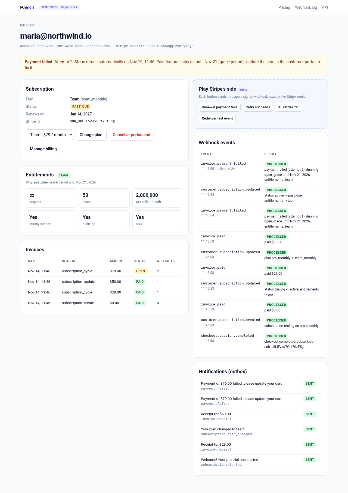
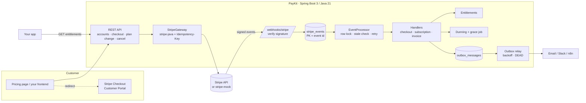
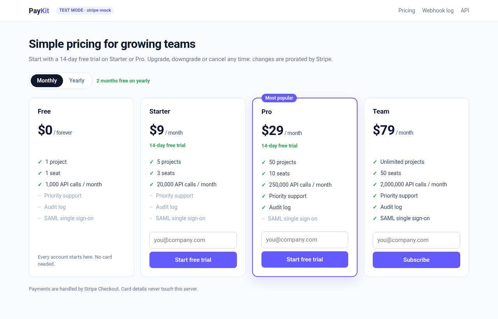
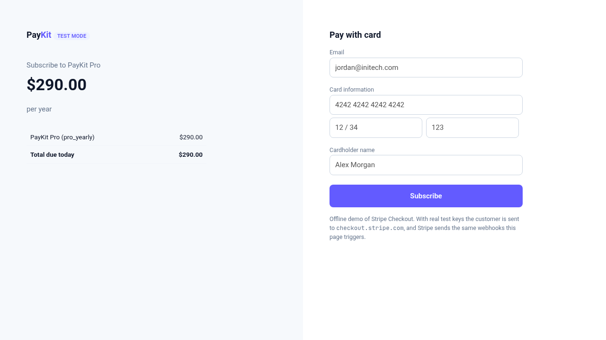
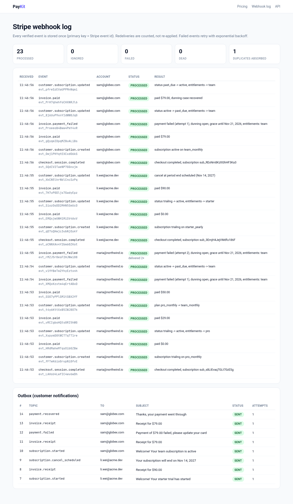
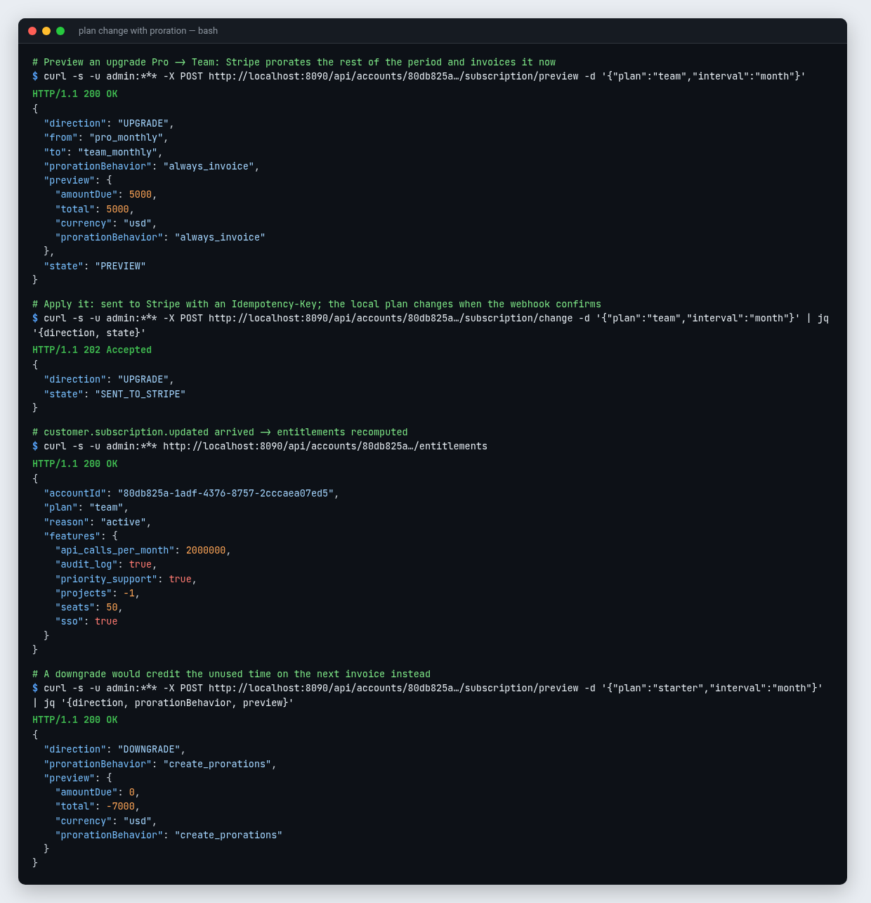
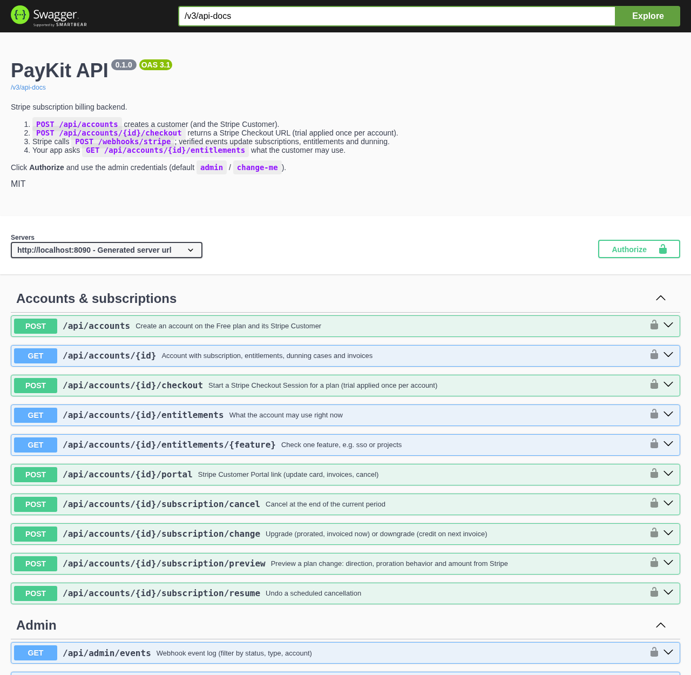
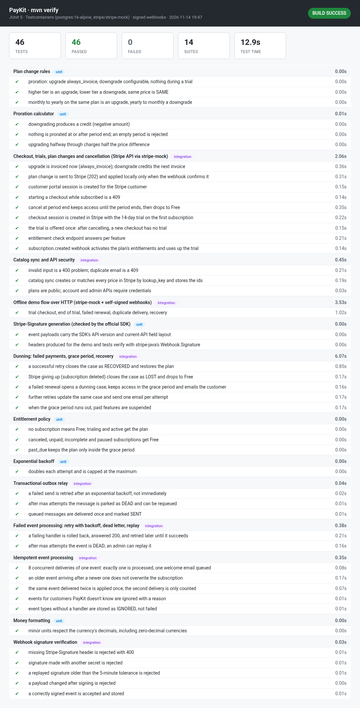

# PayKit: Stripe subscriptions and billing backend (Spring Boot)

[](https://github.com/solace202/paykit/actions/workflows/ci.yml)


PayKit is the billing backend a SaaS product needs on top of Stripe: a plan catalog, **Stripe Checkout** with
free trials, **upgrades and downgrades with proration**, cancel at period end, the **Customer Portal**, and a
**webhook pipeline that is verified, idempotent and retried**. It turns Stripe events into **entitlements**
your app can query ("may this account use SSO?") and runs **dunning** when renewals fail.

Everything runs **offline**: the official [`stripe-mock`](https://github.com/stripe/stripe-mock) validates every
API call against Stripe's OpenAPI spec, and webhooks are signed exactly like Stripe signs them. Switch to real
Stripe test mode by setting two keys and running `stripe listen`.



## Features

- **Catalog sync.** Plans and prices live in the database and are pushed to Stripe idempotently: prices are
  matched by `lookup_key`, a changed amount creates a new price and moves the key (`transfer_lookup_key`).
- **Checkout.** `POST /api/accounts/{id}/checkout` creates a Stripe Checkout Session in subscription mode with
  `client_reference_id`, metadata on the session and the subscription, and a **14-day trial offered once per
  account**.
- **Plan changes.** Upgrades are charged now for the rest of the period (`proration_behavior=always_invoice`,
  `payment_behavior=pending_if_incomplete`, so an upgrade never applies on a failing card). Downgrades credit the
  unused time on the next invoice. Nothing is prorated during a trial. `POST …/subscription/preview` returns
  Stripe's proration preview (`invoices.createPreview`) before the customer confirms.
- **Cancel at period end and resume**, plus a **Customer Portal** session for card updates and invoices.
- **Stripe is the source of truth.** API calls never write billing state locally. The local projection only changes
  when a verified webhook arrives, so the app and Stripe can't drift apart.
- **Webhook pipeline (inbox pattern):**
  1. `Stripe-Signature` is verified with the official SDK (HMAC-SHA256, 5-minute replay tolerance);
  2. the raw event is stored with the **Stripe event id as primary key**, so a redelivery is a no-op and is only counted;
  3. the event is processed in a transaction that **row-locks the event**, so concurrent duplicates wait and then skip;
  4. **out-of-order events** are detected (`event.created` older than the last applied one) and skipped;
  5. a failing handler rolls back, the endpoint still answers 200, and the event is **retried with exponential
     backoff**, then parked as **DEAD** for an admin replay (`POST /api/admin/events/{id}/replay`).
- **Entitlements.** One row per account and feature (`projects`, `seats`, `api_calls_per_month`, `sso`, …),
  recomputed on every subscription change. Your app calls `GET /api/accounts/{id}/entitlements/{feature}` instead
  of reasoning about Stripe statuses.
- **Dunning.** `invoice.payment_failed` opens a case. The customer keeps access during a **grace period** (7 days by
  default) and gets an email per attempt. A scheduled job suspends paid features when the grace period ends.
  `invoice.paid` closes the case as **RECOVERED**, and a cancelled or unpaid subscription closes it as **LOST**.
- **Transactional outbox.** Customer notifications (welcome, receipt, payment failed, trial ending, plan changed,
  cancellation scheduled) are written in the same transaction as the state change. A relay delivers them with
  retries (`FOR UPDATE SKIP LOCKED`, safe with several instances) to the log or any webhook URL (n8n, Zapier, your mailer).
- **Ops:** Flyway, springdoc **Swagger UI**, Actuator probes, RFC 9457 problem responses, HTTP Basic on the API
  and admin pages, multi-stage Docker image, Docker Compose, **GitHub Actions**.
- **Tests:** 46 unit and integration tests on real PostgreSQL 16 and stripe-mock (Testcontainers), including
  signature attacks, concurrent duplicate deliveries, out-of-order events, dunning with a movable clock and the
  full demo flow over HTTP.

## Architecture



**What happens when a renewal fails**

1. Stripe sends `invoice.payment_failed` (attempt 1, next retry in 3 days), then `customer.subscription.updated`
   with status `past_due`.
2. Both are verified, stored and applied once. A dunning case opens with a grace period, entitlements stay on the
   plan with the reason `past_due, grace period until Nov 21, 2026`, and a "please update your card" email is
   queued in the outbox.
3. If a retry succeeds, `invoice.paid` closes the case as RECOVERED. If the grace period runs out first, the
   grace job drops the account to Free features. If Stripe gives up and cancels, the case is LOST.

## Quick start (offline, no Stripe account)

Requirements: Docker with Docker Compose v2. Building outside Docker also needs JDK 21.

```bash
git clone https://github.com/solace202/paykit.git && cd paykit
docker compose up -d --build      # app + PostgreSQL 16 + stripe-mock, DEMO_MODE=true
```

| URL | What |
| --- | --- |
| http://localhost:8080/pricing | Pricing page. Subscribe with any email, pay on the test checkout page |
| http://localhost:8080/account/{id} | Customer billing page with buttons that play Stripe's side (failed renewal, retry, redelivery…) |
| http://localhost:8080/admin/events | Webhook event log and outbox (`admin` / `change-me`) |
| http://localhost:8080/swagger-ui.html | Interactive API docs |

In demo mode every Stripe API call still goes through `stripe-java` to stripe-mock, which rejects invalid
parameters exactly like Stripe would. stripe-mock is stateless, so the app plays Stripe's webhook side itself: it
POSTs **signed** events to its own `/webhooks/stripe`, through the same verification and processing path as
production.

### curl walkthrough

```bash
BASE=http://localhost:8080; AUTH="-u admin:change-me"; J='Content-Type: application/json'

ACC=$(curl -s $AUTH $BASE/api/accounts -H "$J" -d '{"email":"maria@northwind.io"}' | jq -r .id)
curl -s $AUTH $BASE/api/accounts/$ACC/checkout -H "$J" -d '{"plan":"pro","interval":"month"}'
#   -> {"url":"https://checkout.stripe.com/c/pay/cs_test_…","trialDays":14,…}

# after checkout.session.completed + customer.subscription.created arrive:
curl -s $AUTH $BASE/api/accounts/$ACC/entitlements/audit_log      # {"enabled":true,"plan":"pro"}
curl -s $AUTH $BASE/api/accounts/$ACC/subscription/preview -H "$J" -d '{"plan":"team","interval":"month"}'
curl -s $AUTH $BASE/api/accounts/$ACC/subscription/change  -H "$J" -d '{"plan":"team","interval":"month"}'
curl -s $AUTH -X POST $BASE/api/accounts/$ACC/subscription/cancel
curl -s $AUTH "$BASE/api/admin/events?accountId=$ACC"
```

## Run with real Stripe test mode

1. Get a test secret key (`sk_test_…`) from the Stripe dashboard and install the [Stripe CLI](https://stripe.com/docs/stripe-cli).
2. Forward webhooks and copy the `whsec_…` it prints:
   ```bash
   stripe login
   stripe listen --forward-to localhost:8080/webhooks/stripe \
     --events checkout.session.completed,checkout.session.expired,customer.subscription.created,customer.subscription.updated,customer.subscription.deleted,customer.subscription.trial_will_end,invoice.paid,invoice.payment_failed
   ```
3. Create `.env`:
   ```bash
   STRIPE_API_KEY=sk_test_...
   STRIPE_WEBHOOK_SECRET=whsec_...
   STRIPE_API_BASE=
   DEMO_MODE=false
   ```
4. `docker compose up -d --build`. The catalog is created in your Stripe test account on startup. Subscribe on
   `/pricing` with card `4242 4242 4242 4242` (or `4000 0000 0000 0341` to test a failed renewal), and use
   `stripe trigger` or Test Clocks to move subscriptions through renewals.

For production, register `https://your-domain/webhooks/stripe` in the dashboard with the same events and an API
version that matches the SDK (see `Stripe.API_VERSION`). The handlers read the payload as JSON and also accept
the older field layout (`current_period_end` on the subscription, `invoice.subscription`).

## Endpoints

| Method | Path | Auth | Description |
| --- | --- | --- | --- |
| `GET` | `/api/plans` | public | Plans, prices and features |
| `POST` | `/api/accounts` | admin | Create an account (Free) and its Stripe Customer |
| `GET` | `/api/accounts/{id}` | admin | Account, subscription, entitlements, dunning cases, invoices |
| `POST` | `/api/accounts/{id}/checkout` | admin | Stripe Checkout Session `{plan, interval}` |
| `POST` | `/api/accounts/{id}/portal` | admin | Customer Portal URL |
| `POST` | `/api/accounts/{id}/subscription/preview` | admin | Direction, proration behavior, Stripe preview amount |
| `POST` | `/api/accounts/{id}/subscription/change` | admin | Apply a plan change (202, confirmed by webhook) |
| `POST` | `/api/accounts/{id}/subscription/cancel` / `resume` | admin | Cancel at period end / undo |
| `GET` | `/api/accounts/{id}/entitlements[/{feature}]` | admin | Current entitlements / one feature check |
| `POST` | `/api/admin/catalog/sync` | admin | Create or match products and prices in Stripe |
| `GET` | `/api/admin/events` | admin | Webhook log (`status`, `type`, `accountId` filters) |
| `POST` | `/api/admin/events/{id}/replay` | admin | Re-process a stored event |
| `GET` | `/api/admin/outbox` · `POST /api/admin/outbox/{id}/retry` | admin | Notifications and DEAD requeue |
| `POST` | `/webhooks/stripe` | Stripe signature | Webhook endpoint |

The API is meant to be called by your own backend, so it uses HTTP Basic. Put it behind your service auth or
gateway in production.

### Handled events

| Event | Effect |
| --- | --- |
| `checkout.session.completed` / `expired` | Link the Stripe customer, close the local checkout |
| `customer.subscription.created` / `updated` | Upsert the subscription (plan from the price `lookup_key`), recompute entitlements, notify on start, plan change and scheduled cancellation |
| `customer.subscription.deleted` | Status canceled, entitlements → Free, dunning case LOST |
| `customer.subscription.trial_will_end` | "Your trial ends on …" email |
| `invoice.paid` | Store the invoice, close dunning as RECOVERED, receipt email |
| `invoice.payment_failed` | Open or update the dunning case, grace period, "update your card" email |
| anything else | Stored as IGNORED |

## Tests

```bash
mvn verify                         # 46 tests; needs Docker for Testcontainers, no Stripe account
python3 scripts/test_report.py     # readable summary of target/surefire-reports
```

| Test | Proves |
| --- | --- |
| `WebhookSignatureIT` | Missing, forged, tampered and replayed (too old) signatures get 400 and nothing is stored |
| `IdempotencyIT` | A redelivered event is applied once; **8 concurrent deliveries** produce one processing and one email; older events don't overwrite newer state; unknown types and customers are IGNORED |
| `SubscriptionLifecycleIT` | Checkout with trial (stripe-mock), trial once per account, 409 when already subscribed, upgrade/downgrade proration rules, change applied only on webhook, cancel at period end then Free, portal, feature checks |
| `DunningIT` | Grace period keeps access, one email per attempt, grace expiry suspends features, RECOVERED and LOST |
| `EventRetryIT` | A failing handler rolls back, is retried after backoff, ends DEAD after max attempts and can be replayed |
| `OutboxRelayIT` | Exactly-once enqueue by dedup key, backoff between attempts, DEAD and requeue |
| `DemoFlowIT` | The whole offline demo over real HTTP: checkout, trial end, failed renewal, duplicate delivery, recovery |
| unit tests | Proration maths, upgrade/downgrade rules, entitlement policy, backoff, signatures checked by stripe-java |

## Configuration

| Variable | Default | Purpose |
| --- | --- | --- |
| `STRIPE_API_KEY` | `sk_test_123` | Secret key (any value works against stripe-mock) |
| `STRIPE_API_BASE` | – | Empty = api.stripe.com; `http://localhost:12111` = stripe-mock |
| `STRIPE_WEBHOOK_SECRET` | dev value | `whsec_…` from `stripe listen` or the dashboard |
| `STRIPE_WEBHOOK_TOLERANCE` | `300s` | Max signature age (replay protection) |
| `STRIPE_SYNC_CATALOG` | `true` | Sync the catalog to Stripe on startup |
| `DEMO_MODE` | `false` (`true` in Compose) | Offline demo: the app plays Stripe's webhook side. Never with live keys |
| `DUNNING_GRACE_PERIOD` | `7d` | Access kept while Stripe retries a failed renewal |
| `DOWNGRADE_PRORATION` | `create_prorations` | Or `none` |
| `EVENT_MAX_ATTEMPTS` / `OUTBOX_MAX_ATTEMPTS` | `8` / `6` | Before DEAD |
| `NOTIFY_WEBHOOK_URL` | – | POST notifications as JSON (with `Idempotency-Key`) instead of logging them |
| `ADMIN_USER` / `ADMIN_PASSWORD` | `admin` / `change-me` | HTTP Basic for the API and admin pages |
| `PUBLIC_URL` | `http://localhost:8080` | Base for Checkout success/cancel and portal return URLs |
| `DB_URL` / `DB_USER` / `DB_PASSWORD` | local Postgres | Database |

## Screenshots

| | |
| --- | --- |
|  |  |
|  |  |
|  |  |

Regenerate them with `python scripts/capture_screenshots.py --base-url http://localhost:8080` on a fresh stack.

## Project structure

```
src/main/java/dev/paykit
├── catalog/      plans, prices, idempotent sync to Stripe
├── account/      accounts + Stripe customers
├── billing/      checkout, plan change, cancel, proration rules
├── stripe/       StripeGateway (stripe-java, Idempotency-Keys)
├── webhook/      signature check, event inbox, processor, handlers, retry job, admin API
├── entitlement/  policy + materialised entitlements
├── dunning/      cases, grace period job
├── outbox/       transactional outbox + relay with backoff
├── demo/         offline mode: stripe-mock decorator, signed event factory, demo checkout
└── web/          pricing/account/admin pages, problem+json errors
```

## License

MIT
